<p align="center">
  <picture>
    <source media="(prefers-color-scheme: dark)" srcset="docs/assets/hero-dark.svg">
    
  </picture>
</p>

**skills-g-hub is a shared set of 30 skills that give your coding agent a repeatable way to take a software change from idea to verified result: settle the plan, write it down, build it, review it.** It works in Claude Code, Codex and Antigravity.

At the center is **[`hub-workflow`](skills/hub-workflow/SKILL.md)**, a router skill. It looks at what you asked for and picks the shortest route through the other skills: a one-line fix goes straight to build and review, an unsettled feature is questioned, specced and sliced into tickets first. **It is conditional guidance, not an automation engine.**

[Why](#why-a-workflow-not-just-a-prompt) · [Routes](#one-router-many-routes) · [Journey](#a-feature-start-to-finish) · [In practice](#what-it-looks-like-in-practice) · [Skills](#the-30-skills) · [Install](#install) · [Trust](#trust-limits-and-what-to-read-first)

```bash
npx skills add Hesham-14/skills-g-hub --global --agent claude-code --agent codex --agent antigravity-cli --skill '*' -y
```

## Why a workflow, not just a prompt

Coding agents can write a diff and still lose the original intent. This hub gives them a route and a way to check the result.

| Without a workflow | With skills-g-hub |
| --- | --- |
| The agent starts coding from a half-formed plan. | An unsettled plan is questioned first. Agreed terms and important decisions are saved, with their reasons. |
| A big feature arrives as one giant diff. | A spec, then verifiable tickets with acceptance criteria and blockers. |
| "The tests pass" is taken on faith. | Review compares the diff to the ticket, re-runs the project's real gates and applies the guard that matches what changed. Delegated work is verified independently. |
| UI ships unseen. | UI review needs rendered evidence per viewport and theme. A check that did not run is recorded as not run, never as passed. |
| The agent quietly does more than you asked. | Delegating to another agent, posting review comments, pushing and merging are separate actions that only happen within what you authorized. Missing skills are reported, never installed silently. |

## One router, many routes

`hub-workflow` does not run a fixed pipeline. It reads the situation and sends the task down the route that fits.

<picture>
  <source media="(prefers-color-scheme: dark)" srcset="docs/assets/route-dark.svg">
  
</picture>

**Guidance, not a scheduler.** The connections between skills are instructions the agent follows when their condition holds. Nothing runs in the background, and a connection is never permission to publish, merge or delegate. Planning-only requests end with planning, and direct implementation is the default. The full map, with every condition, is in [docs/workflow.md](docs/workflow.md).

## A feature, start to finish

<picture>
  <source media="(prefers-color-scheme: dark)" srcset="docs/assets/journey-dark.svg">
  
</picture>

An illustrative route for a feature large enough to need every step. You can enter at any step: with a spec already written, start at the tickets; if you only want a review, ask for a review. The moving highlight shows the hand-off of context, not background execution.

## What it looks like in practice

| You say | What the hub guides |
| --- | --- |
| "Add CSV export to the reports page. We haven't decided how big exports should work." | The plan is unsettled, so `grill-me-code` questions it and saves the decisions. Once it is agreed and too big for one change, `to-spec` then `to-tickets`. Each ticket is built with `tdd` and reviewed. |
| "This job fails every few days and nobody knows why." | `diagnosing-bugs` reproduces it first and keeps a record of eliminated hypotheses. The fix reuses that evidence, and `tdd` adds the regression test. |
| "Build the new settings screen." | `ui-engineering` sets how much process the task deserves. The result is looked at in a real browser per viewport and theme, then `ui-guard` reviews it with that evidence. A significant flow gets a browser test from `ui-e2e-tests`. |
| "Have Codex build this, then review it." | With your authorization, `codex-delegate` hands over a bounded brief. The returned diff is checked against the ticket and the gates are re-run before anything is accepted. |
| "Review this branch and get a second opinion before I merge." | The matching guards run on what changed. `debate-review` adds two independent reviewers and an adjudication because you asked for it. It needs reviewer lanes set up with `delegate-setup`. |
| "Fix the typo in the header." | No workflow at all: a small edit needs no coordination, so the agent just edits and checks it. |

## The 30 skills

Open a skill to read its triggers and boundaries.

**Coordinate and set up**

- [hub-workflow](skills/hub-workflow/SKILL.md): routes a task to the shortest suitable path
- [setup-matt-pocock-skills](skills/setup-matt-pocock-skills/SKILL.md): records a project's tracker, domain docs and real verification commands (you invoke it)
- [delegate-setup](skills/delegate-setup/SKILL.md): configures which agent handles which kind of work

**Decide and plan**

- [grill-me-code](skills/grill-me-code/SKILL.md): stress-tests a technical plan; saves terms and decisions
- [wayfinder](skills/wayfinder/SKILL.md): maps interdependent decisions across sessions
- [prototype](skills/prototype/SKILL.md): disposable experiment that answers a behavior or UI question
- [to-spec](skills/to-spec/SKILL.md): turns an agreement into a concise spec
- [to-tickets](skills/to-tickets/SKILL.md): splits a spec into verifiable tickets with blockers

**Shape architecture**

- [improve-codebase-architecture](skills/improve-codebase-architecture/SKILL.md): finds friction that has real maintenance cost
- [codebase-design](skills/codebase-design/SKILL.md): picks simple interfaces that serve real behavior

**Diagnose and build**

- [diagnosing-bugs](skills/diagnosing-bugs/SKILL.md): evidence-first diagnosis that keeps the results of each attempt
- [tdd](skills/tdd/SKILL.md): failing behavior test first, then the code that passes it
- [codex-delegate](skills/codex-delegate/SKILL.md): authorized hand-off of a bounded task to Codex, then review of the result
- [claude-delegate](skills/claude-delegate/SKILL.md): the same, to another Claude Code process
- [agy-delegate](skills/agy-delegate/SKILL.md): the same, to Antigravity

**Review the result**

- [clean-code-guard](skills/clean-code-guard/SKILL.md): production code quality and generated-code failure modes
- [test-guard](skills/test-guard/SKILL.md): test quality; guards against weakened coverage
- [docs-guard](skills/docs-guard/SKILL.md): documentation matches the source
- [wp-guard](skills/wp-guard/SKILL.md): WordPress rules
- [woo-guard](skills/woo-guard/SKILL.md): WooCommerce rules
- [debate-review](skills/debate-review/SKILL.md): two independent reviewers, then adjudication (on request or project policy)

**Build and check UI**

- [ui-engineering](skills/ui-engineering/SKILL.md): from user goal to a UI that has been looked at in a browser
- [ui-design-system](skills/ui-design-system/SKILL.md): extracts and extends shared tokens and components
- [ui-guard](skills/ui-guard/SKILL.md): evidence-based UI review and an audit record
- [ui-e2e-tests](skills/ui-e2e-tests/SKILL.md): real-browser flow, screenshot and accessibility tests
- [frontend-design](skills/frontend-design/SKILL.md): visual direction for new or redesigned UI

**Support the work**

- [research](skills/research/SKILL.md): primary-source research with written findings
- [handoff](skills/handoff/SKILL.md): carries context to another session (you invoke it)
- [resolving-merge-conflicts](skills/resolving-merge-conflicts/SKILL.md): resolves an in-progress conflict, keeping both sides' intent
- [writing-for-agents](skills/writing-for-agents/SKILL.md): writes clear instructions for agents (skills, AGENTS.md)

Install the cooperating skills together for the full workflow; any single skill also works on its own. The UI skills have their own [operator guide](docs/ui-engineering.md). The [authoring template](templates/skill-template/) is scaffolding, not an installed skill.

## Install

```bash
npx skills add Hesham-14/skills-g-hub --global --agent claude-code --agent codex --agent antigravity-cli --skill '*' -y
```

`--agent` takes one agent per flag; a comma-separated list is rejected. Name the agents you use, or pass `--agent '*'` for every supported one. For a smaller install, replace `--skill '*'` with the skills you want, for example `--skill hub-workflow --skill tdd`.

The content lands once in `~/.agents/skills/`, which Codex and Antigravity CLI read directly. Claude Code gets symlinks from `~/.claude/skills/`. That copy is independent of this repository: run the command again to update. Installing skills does not install or sign in the implementer CLIs, browsers or model accounts they use.

**Then, in each project**, run `setup-matt-pocock-skills` yourself. It explores the repo, shows what it found, and after you confirm writes `docs/agents/` with the issue tracker, domain layout and the project's real build, test and run commands. `hub-workflow` reads that file. Run it again later and it checks the existing setup and shows a diff before changing anything.

**Then just ask.** For example: "Use hub-workflow to plan and build saved searches, and check the result against the agreed criteria." Invocation syntax depends on your runtime, and you do not have to name the skills.

Requirements: Node 18+ for the scripts and offline tests. `ui-guard`'s browser capture needs Node 22+ and an installed Chrome, Chromium or Edge; without them agents report rendered checks as unavailable. Details are in [docs/maintaining.md](docs/maintaining.md#requirements).

## Trust, limits and what to read first

- **Skills are instructions.** The text of a `SKILL.md` is what the agent obeys, so read what you install. Markdown is inspectable, not a safety guarantee. [SKILL-SAFETY.md](SKILL-SAFETY.md) is the vetting checklist and the record of what was audited and removed.
- **Some skills ship scripts.** 17 Node scripts (Node built-ins only): the delegate relays, the `debate-review` runner, and two UI helpers (`capture.mjs`, `ui-audit.mjs`). The delegates launch the agent CLI you already have installed. `debate-review` keeps clones and artifacts in `~/.cache/debate-review/` and, for pull requests, calls your own `gh`, `glab` or `az` CLI (`az` supplies an Azure token). Each script is covered in SKILL-SAFETY.md.
- **Updates have a review boundary.** The vendor sync flags non-documentation content in upstream sources but does not decide whether it is safe; a person reads it. Local adaptations are updated by hand.
- **You stay in control.** Delegation, posting review comments, pushing and merging only happen within what you authorized. Nothing is installed or configured silently.
- **Honest limits.** The workflow is guidance, so an agent can still skip a step. No time or cost savings are claimed. The offline tests check the tooling and routing contracts, not model quality. Live activation of the UI skills was measured on Claude Code only; Codex and Antigravity were not measured. `debate-review` needs authenticated reviewer agents set up first. UI screenshots can contain application data, so keep audit artifacts out of Git.

## Credits and licences

Most of the hub is adapted from open-source skill sets. Their licences are kept alongside the code and in [THIRD_PARTY_NOTICES.md](THIRD_PARTY_NOTICES.md):

- [mattpocock/skills](https://github.com/mattpocock/skills): the planning and implementation skills
- [amElnagdy/guard-skills](https://github.com/amElnagdy/guard-skills), [delegate-skills](https://github.com/amElnagdy/delegate-skills) and [review-skills](https://github.com/amElnagdy/review-skills): the review guards, delegates and `debate-review`
- [anthropics/skills](https://github.com/anthropics/skills): `frontend-design`
- [Vercel web-interface-guidelines](https://github.com/vercel-labs/web-interface-guidelines), [Vercel agent-skills](https://github.com/vercel-labs/agent-skills) and [Impeccable](https://github.com/pbakaus/impeccable): the rules and ideas behind the UI skills

`hub-workflow`, the UI skills and the local adaptations were written for this repository; [local-sources.json](local-sources.json) records exactly what each adaptation is based on. The repository is [MIT](LICENSE).

## Contributing and maintaining

Add a skill by copying `templates/skill-template`, refresh vendored upstream skills with `scripts/sync-vendor.sh`, and run the offline checks before opening a pull request. All of it is in [docs/maintaining.md](docs/maintaining.md). Contributor conventions are in [AGENTS.md](AGENTS.md).
