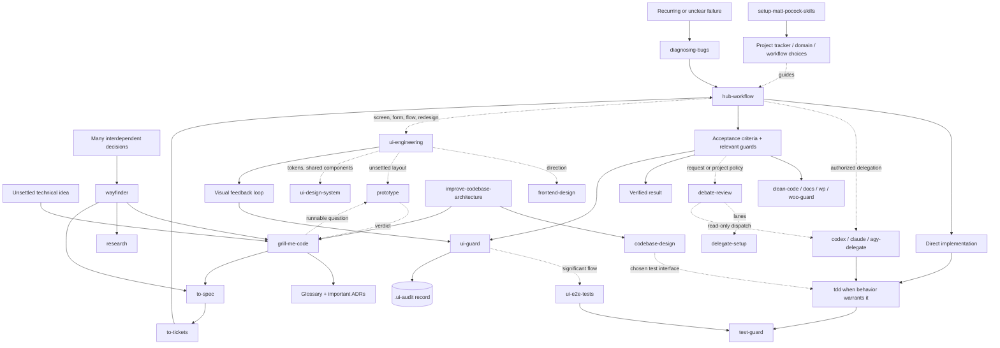

# Skills hub workflow

The hub contains 30 usable skills; the authoring template lives in `templates/`. The four UI skills
(`ui-engineering`, `ui-design-system`, `ui-guard`, `ui-e2e-tests`) were added on
2026-11-07; see [UI engineering](#ui-engineering). Eleven skills were added in the
2026-09-17 change; `grill-me-code` gained persistent domain terms and decision rationale.
No installed agent copy or global/project fleet configuration is updated by editing
this repository.

## Ownership

- `vendor.json` still owns the existing upstream delegates, guards and utilities.
  Their files are unchanged. `vendor.lock.json` records those copies.
- `local-sources.json` pins the sources for the new local adaptations: Matt Pocock
  v1.2.3 and review-skills commit `5b748c654bb060ef6bf86d0e7ae123979082a88a`.
  Each adapted folder retains its upstream MIT licence.
- These adaptations live outside vendor ownership. Upstream sync cannot overwrite
  their narrowed triggers, hub connections or review-script fixes. Update them
  manually after comparing the pinned source and reviewing the complete diff.
- `hub-workflow` is the local coordination layer. New skills connect to it by
  name. It keeps workflow integration out of vendored guard/delegate folders.

The original Matt skills refer to grilling/domain-modeling and implement/code-review.
The local versions use the existing technical grilling skill, its domain-records
reference, and hub-workflow instead. All new entrypoints allow implicit discovery;
this permits conditional use within a matching task, not guaranteed execution or
permission to install tools, launch delegates or publish.

## Routes

Arrows describe instructions and information flow. They do not make this graph a
scheduler. A small bounded change can go straight to implementation and relevant
review, without a spec, tickets, architecture scan, or independent debate.

## What is connected now

| Connection | Owner and condition |
| --- | --- |
| Persist glossary and important decisions | `grill-me-code/references/domain-records.md`, as terms and consequential choices settle. |
| Spec → tickets → execution | `to-spec`, `to-tickets`, `hub-workflow`; only continue when the user's request includes the later work. |
| Diagnosis → TDD/fix | `diagnosing-bugs`; reuse reproduction and eliminated hypotheses. |
| Execution → relevant review | `hub-workflow/references/review.md`; criteria plus guards, for both direct and delegated code. |
| TDD → test quality | `tdd` refers to `test-guard`; there is no second copied test-rules manual. |
| Review → correction | `hub-workflow`; bounded delta with the original evidence when fixing is authorized. |
| Architecture → decision records → implementation | `improve-codebase-architecture`, `codebase-design`, `grill-me-code`. |
| Local/remote spec → independent reviewers | `debate-review --spec <file>` carries the content to main, debate and adjudication briefs. |
| Project configuration → portable routing | Setup writes pointers to project docs and the available hub-workflow skill. |
| UI request → class → stack strategy → visual loop | `ui-engineering`; one stack reference per task, `frontend-design`/`prototype`/`ui-design-system` only when the class needs them. |
| UI change → evidence-based review → audit record | `ui-guard` row in `hub-workflow/references/review.md`; `ui-audit.mjs` for significant work. |
| Significant UI flow → browser test → test review | `ui-e2e-tests`, then `test-guard`. |
| Project UI commands → visual loop | Setup's UI verification rows in `docs/agents/workflow.md`. |

Optional tools are discovered in the current runtime. Missing skills can be handled
with the hub's brief fallback procedure, without pretending they ran or installing
them. Individual new skills can be invoked directly; install the cooperating hub
skills together for the full experience.

## Where implement and code-review functionality lives

Upstream `implement` connects coding, TDD, checks, review and commit. Existing
`codex-delegate/SKILL.md` and its `references/dispatch-and-poll.md` cover delegated
execution. Its `references/review-and-land.md` covers real gates, diff against
brief, generated-code failure modes and the commit boundary. Claude and agy have
corresponding references. The new hub execution/review references extend the
coordination to direct implementation and spec-linked tickets, and TDD is now explicit.

Upstream `code-review` deliberately splits Standards and Spec review across
independent agents. Existing delegates already compare the diff to the brief and
run guards; that was functional overlap, not the identical review arrangement.
The new hub review contract explicitly checks acceptance criteria and relevant
standards. `debate-review` adds independent reviewers plus adjudication when requested.
There is still no unconditional two-agent review of every small change.

## Project setup and the first trial

After installing the selected skills yourself, invoke setup-matt-pocock-skills in
a project. It explores the repo first, presents what it found and what it proposes,
and writes only after the user confirms. Output is `docs/agents/`: issue tracker,
triage labels, domain layout and `workflow.md`, the repo's real verification
commands. When `docs/agents/` already exists the run becomes a check: it reports the
state and shows a diff before editing any existing file. `hub-workflow` reads
`docs/agents/workflow.md` when the working project has one. The skill is
prompt-driven with no scripts, and does not configure model lanes, install skills
or post issues.

Use a real recurring bug to try diagnosis, then a feature to try spec/tickets.
Track total available token/cost records, failed attempts and regressions; no
measured savings are claimed yet. Debate review needs available authenticated
implementers and review-main/review-debate lanes or explicit implementer choices.
A real-model smoke test of that setup is still open.

## Deliberate limits and useful next connections

- Per-project review policy can require debate for a defined change category. It
  remains optional until that policy is deliberately set; do not infer PR risk from
  lines changed alone. Posting stays a separate authorized action with `--post`.
- A ready-ticket scheduler with atomic claims could help concurrent agent work.
  The current local files are not locks; a shared human assignee is not a session
  identity. Current instructions coordinate a writer and isolate parallel changes.
- CI could enforce project gates before merging agent PRs. Skills advise checks;
  this repository adds no CI integration or automatic merging to other projects.
- Architecture improvements need demonstrated friction. No periodic whole-repo
  scan or speculative abstraction is enabled merely by installing the skill.

## UI engineering

Four local skills, connected by name, with no new orchestrator:

| Skill | Owns | Stops at |
| --- | --- | --- |
| `ui-engineering` | Task class (trivial / standard / significant / redesign), UX discovery, design direction hand-off, stack strategy, implementation floor, visual feedback loop | Visual direction (`frontend-design`), experiments (`prototype`), system-wide tokens (`ui-design-system`) |
| `ui-design-system` | Extracting, consolidating and extending the project's own tokens, themes, RTL rules and shared components | A single change that fits the existing system |
| `ui-guard` | Evidence-tagged UI review (P0–P3), gate statuses, the audit record | Generic code quality (`clean-code-guard`), test code (`test-guard`) |
| `ui-e2e-tests` | Real-browser flow tests, visual regression, axe and keyboard checks, browser-error detection, with the project's own tooling | Unit/component tests (`tdd`), test review (`test-guard`) |

Depth is proportional. A trivial CSS fix is: implement, look once, `ui-guard` on the
diff; no spec, prototype or record. Redesigns stop for the user's approval of the
direction before production edits.

**Evidence, not claims.** The visual loop needs a rendered look per viewport, theme and
state that the change touched. `ui-guard/scripts/capture.mjs` gives every agent a
browser path without packages: it drives an installed Chrome over the DevTools
protocol (local URLs only, throwaway profile) for exact-viewport screenshots, light/dark
emulation, console errors, failed requests, DOM checks and performance entries.
`ui-guard/scripts/ui-audit.mjs` records each significant run against
`ui-guard/references/ui-audit.schema.json`: baseline and result commits, stack,
environment, commands with captured exit codes, evidence with SHA-256, findings,
metrics and agent usage only when the runtime reported it. Unrun checks stay
`not_run`; a visual `pass` without a screenshot is rejected; `compare` refuses to judge
metrics across different environments or below a noise floor.

`ui-e2e-tests` covers the browser level; a future `test-lifecycle` orchestrator would route to it. Upstream choices are in
[ui-upstream-assessment.md](../files/ui-upstream-assessment.md); the operator guide is
[ui-engineering.md](ui-engineering.md).

## Standalone and intentionally omitted

`frontend-design` supports real UI and UI prototypes, reached through `ui-engineering` for production work. `research`, `handoff`, `resolving-merge-conflicts`
and `writing-for-agents` are supporting tools used only when their situation applies.
`templates/skill-template` is authoring scaffolding, not a runtime workflow stage.

Not added: ask-matt, wait-what, to-questionnaire, implement, code-review, standalone
grilling/grill-with-docs/domain-modeling, triage, teach and wizard. Triage classifies
incoming reports; teach maintains a learning workspace; wizard builds an interactive
script for human-only setup steps. None is needed for the selected initial workflow.

## Verification

- `node --test tests/debate-review.test.mjs`: offline integration against fake external
  model/CLI responses, real temporary Git repos and the real fleet trust resolver.
- `node --test tests/ui-audit.test.mjs tests/ui-workflow.test.mjs`: the audit recorder,
  stack detection, real-browser capture against seeded-defect fixtures (skipped without
  an installed Chrome/Chromium/Edge or Node 22), UI skill structure, routing contracts
  and the activation case set.
- `node tests/ui-workflow/activation-eval.mjs`: opt-in live activation check through an
  installed `claude` CLI; costs model usage.
- `python3 <skill-creator>/scripts/quick_validate.py skills/<name>`: skill structure.
  Its allowed-key list is out of date: it rejects `disable-model-invocation` and
  `argument-hint`, which are valid Claude Code frontmatter. `setup-matt-pocock-skills`
  and `handoff` fail on that basis alone. Do not remove those keys to satisfy it.
- `jq empty vendor.json vendor.lock.json local-sources.json`: metadata syntax.
- `npx skills add . --list --full-depth`: discovery only; this does not install skills.
- `./scripts/sync-vendor.sh --check`: existing upstream content drift, read-only.

Tests verify the review pipeline, not real-model quality or guaranteed skill routing
across every runtime. The payload audit is in
[debate-review-integration-audit.md](../files/debate-review-integration-audit.md).
